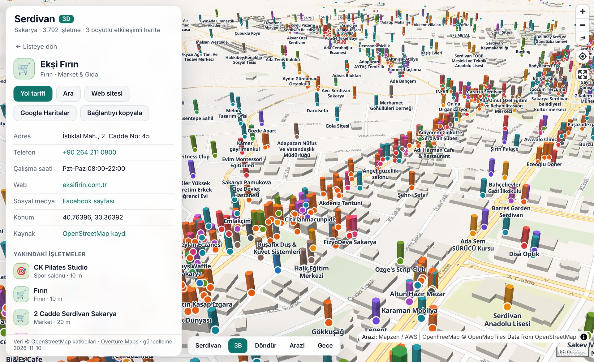

# Serdivan 3D İşletme Haritası

Sakarya'nın **Serdivan** ilçesindeki işletmeleri gösteren, tarayıcıda çalışan etkileşimli 3 boyutlu harita.
Binalar 3B çizilir (isteğe bağlı arazi yükseltisiyle); **3.792 işletmenin** her biri kategorisine göre
renklendirilmiş bir sütun ve nokta olarak haritaya yerleştirilir. Kurulum, derleme adımı veya API anahtarı gerekmez.



## Neler yapılabilir?

- **3B gezinme** – sağ tık + sürükle (dokunmatikte iki parmak) ile haritayı eğip döndürün; `3B`, `Döndür`,
  `Arazi` ve `Gece` düğmeleriyle görünümü değiştirin. (`Arazi` tepeleri ve vadileri de 3B yapar; ağır bir
  katman olduğu için varsayılan olarak kapalıdır.)
- **İşletmeye tıklama** – haritadaki bir sütuna/noktaya ya da listedeki bir satıra tıklayınca harita oraya
  uçar ve adres, telefon, web sitesi, çalışma saatleri, yol tarifi ve yakındaki işletmeler açılır.
- **Arama** – ad, tür, sokak veya marka ile arayın (Türkçe karakter duyarsız: `kofte` → `Köfte`).
- **Kategori süzgeci** – 13 kategoriyi (yeme-içme, market, sağlık, eğitim…) tek tıkla açıp kapatın.
- **Yalnızca görünen alan** – listeyi o an ekranda görünen bölgeyle sınırlayın.
- **Paylaşılabilir bağlantı** – harita konumu ve seçili işletme adres çubuğuna yazılır; bağlantıyı kopyalayıp
  gönderdiğiniz kişi aynı görünümü açar.
- **Konumum** – sağ üstteki düğmeyle kendi konumunuzu haritada görün.

## Çalıştırma

Tarayıcılar `file://` üzerinden veri dosyası okumaya izin vermediği için sayfayı küçük bir yerel sunucuyla açın:

```bash
python -m http.server 8000
```

Ardından <http://localhost:8000> adresine gidin.

### İnternette yayımlama (GitHub Pages)

Depo ayarlarında **Settings → Pages → Build and deployment → Source: Deploy from a branch** seçip
`main` dalını ve `/ (root)` klasörünü işaretleyin. Birkaç dakika sonra harita
`https://<kullanıcı-adı>.github.io/<depo-adı>/` adresinde yayında olur.

## Veri

İşletmeler iki açık veri kaynağından derlenir ve `data/isletmeler.geojson` dosyasında tutulur:

| Kaynak | Ne sağlar? | Lisans |
| --- | --- | --- |
| [OpenStreetMap](https://www.openstreetmap.org) | Gönüllülerin elle girdiği, ayrıntılı (çalışma saati, mutfak, erişilebilirlik…) kayıtlar | ODbL 1.0 |
| [Overture Maps – Places](https://overturemaps.org) | Meta, Microsoft, Foursquare gibi sağlayıcılardan derlenen çok daha geniş işletme listesi | CDLA-Permissive 2.0 |

İki kaynakta da bulunan işletmeler (yakın konum + benzer ad) tek kayıtta birleştirilir; OpenStreetMap
kaydı esas alınır, eksik telefon/web bilgisi Overture'dan tamamlanır.

> **Kapsam hakkında dürüst not:** Bu harita Serdivan'daki *açık veride yer alan* bütün işletmeleri gösterir;
> resmî bir sicil değildir. Yeni açılmış ya da hiçbir açık veri kaynağına girilmemiş işletmeler eksik
> olabilir, kapanmış bazı işletmeler de hâlâ görünebilir. Overture kayıtlarının konumu yaklaşık olabilir
> (ayrıntı panelinde her kaydın kaynağı ve güven puanı yazar). Eksik bir işletmeyi
> [OpenStreetMap'e ekleyebilir](https://www.openstreetmap.org/edit) ve veriyi yeniden üretebilirsiniz.

### Veriyi güncelleme

```bash
pip install pyarrow              # yalnızca Overture verisi için gerekli
python scripts/veri_guncelle.py  # data/ klasörünü yeniden üretir
```

Yararlı seçenekler:

| Seçenek | Açıklama |
| --- | --- |
| `--onbellek ham` | İndirilen ham yanıtları `ham/` klasöründe saklar; tekrar çalıştırınca ağdan indirmez |
| `--overture-yok` | Yalnızca OpenStreetMap kullanır (ek paket gerekmez) |
| `--guven 0.7` | Overture kayıtları için en düşük güven puanı (varsayılan `0.5`; yükselttikçe daha az ama daha güvenilir kayıt) |

Betik; ilçe sınırını indirir, işletmeleri sınır çokgeninin içinde kalanlarla sınırlar (ışın atma
yöntemiyle nokta-çokgen testi), etiketleri Türkçe kategori ve tür adlarına çevirir ve iki kaynağı birleştirir.

## Proje yapısı

```
index.html                 Sayfa iskeleti
css/style.css              Arayüz (açık/koyu tema, mobil alt sayfa)
js/app.js                  Harita, katmanlar, arama, süzgeç ve ayrıntı paneli
data/isletmeler.geojson    İşletmeler (betikle üretilir)
data/serdivan-sinir.geojson İlçe sınırı (betikle üretilir)
scripts/veri_guncelle.py   Veri indirme + dönüştürme + birleştirme
scripts/overture.py        Overture Maps indirme ve Türkçe sınıflandırma
vendor/                    MapLibre GL JS (BSD-3-Clause)
```

## Kullanılan teknolojiler

- [MapLibre GL JS](https://maplibre.org) – WebGL tabanlı 3B harita motoru (depoya dahil, CDN gerekmez)
- [OpenFreeMap](https://openfreemap.org) – anahtarsız, ücretsiz vektör harita karoları (OpenMapTiles şeması)
- [Mapzen Terrain Tiles](https://registry.opendata.aws/terrain-tiles/) – arazi yükseltisi
- Python 3 – veri hazırlama betikleri

## Lisans

Kod [MIT](LICENSE) lisanslıdır. Veri kendi lisanslarına tabidir: © OpenStreetMap katkıcıları (ODbL 1.0),
© Overture Maps Foundation (CDLA-Permissive 2.0). Harita karoları © OpenMapTiles, veri © OpenStreetMap katkıcıları.
